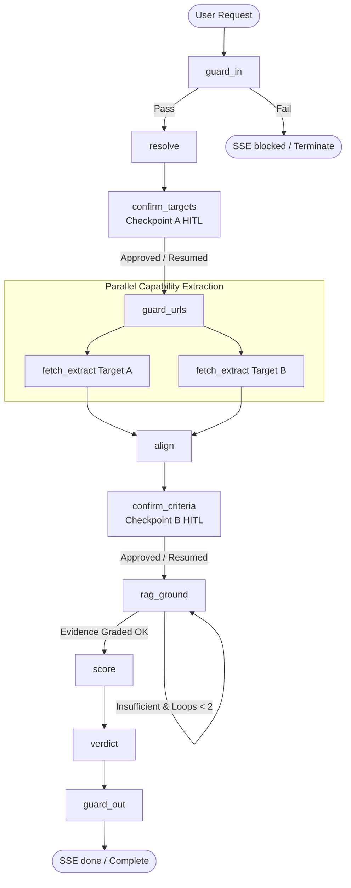

# LangGraph Agent Architecture & State Graph

## Metadata
- **Purpose**: Details the multi-agent graph architecture, complete state schema, node responsibilities, parallel fan-out execution, and routing conditions.
- **Scope**: Covers state definitions, execution nodes, parallel execution paths for comparison targets, interrupt checkpoints, and visual flowcharts.
- **Owner files**: `backend/app/agents/state.py`, `backend/app/agents/graph.py`, `backend/app/agents/nodes/*`.

---

## 1. Graph State Schema (`state.py`)
The unified `CompareState` data structure tracked across graph execution contains:
- `thread_id`: Unique identifier for the comparison session and SQLite checkpoint thread.
- `user_query`: Original user comparison instruction.
- `target_a_raw`: Initial name, URL, or identifier for side A.
- `target_b_raw`: Initial name, URL, or identifier for side B.
- `resolved_target_a`: Structured `CatalogItem` for side A (canonical name, URL, domain, entity type).
- `resolved_target_b`: Structured `CatalogItem` for side B (canonical name, URL, domain, entity type).
- `criteria`: List of aligned comparison capability criteria.
- `capabilities_a`: Extracted capability specifications, features, and evidence for target A.
- `capabilities_b`: Extracted capability specifications, features, and evidence for target B.
- `aligned_matrix`: Structured comparative matrix rows mapping criteria to evidence for both sides.
- `rag_grounding_context`: Retrieved document snippets and similarity scores from RAG stores.
- `scores`: Quantitative capability scores and calculated winner metrics.
- `verdict`: Final comparative analysis, tradeoffs, and recommendations.
- `guardrail_status`: State of L1-L4 guardrail validations, flags, and violation records.
- `interrupt_data`: Payload and metadata presented to human operators during pause states.
- `error_message`: Error information if processing halts or fails.

---

## 2. Graph Nodes & Responsibilities

### 2.1 `guard_in`
- Executes L1 input checks and prompt injection detection against incoming comparison queries.
- Routes to termination if malicious intent or policy violations are confirmed.

### 2.2 `resolve`
- Identifies and canonicalizes target entities and websites for both side A and side B.
- Determines whether targets are SaaS websites, mobile apps, GitHub repositories, models, or media items.

### 2.3 `confirm_targets` (Checkpoint A)
- Checks if `HITL_CONFIRM_TARGETS=true`.
- If enabled, triggers a LangGraph interrupt yielding an SSE `interrupt` event allowing the operator to verify or edit target URLs and metadata before web scraping begins.

### 2.4 `guard_urls`
- Executes L2 URL validation, redirect resolution, domain blocklists, Google Safe Browsing checks, and SSRF address validation for resolved/edited URLs.

### 2.5 Parallel Fan-Out: `fetch_extract`
- The graph fans out into two parallel asynchronous tasks:
  - `fetch_extract_a`: Scrapes, queries tools, screens content via L3 guardrail, and extracts structured capabilities for Target A.
  - `fetch_extract_b`: Scrapes, queries tools, screens content via L3 guardrail, and extracts structured capabilities for Target B.
- Employs fallback scraper chain (lightweight HTTP parser with Trafilatura -> Playwright headless browser fallback when needed).

### 2.6 `align`
- Synchronizes output from parallel extraction tasks.
- Reconciles disparate feature taxonomies and generates a unified, objective set of comparative capability criteria.

### 2.7 `confirm_criteria` (Checkpoint B)
- Checks if `HITL_CONFIRM_CRITERIA=true`.
- If enabled, pauses execution to allow the operator to adjust, add, or prioritize comparison criteria.

### 2.8 `rag_ground`
- Queries indexed user documents for proprietary benchmarks, internal policies, or feature requirements.
- Uses agentic grading loop (`grader.md`) to evaluate evidence; re-writes queries and retries up to `MAX_REWRITE_LOOPS=2`.

### 2.9 `score`
- Computes capability scores, weighted trade-off balances, and similarity alignments across all criteria.

### 2.10 `verdict`
- Synthesizes an executive comparative verdict, highlighting strengths, weaknesses, and clear recommendations. Streams live tokens to the client.

### 2.11 `guard_out`
- Executes L4 output screening on final verdict and tabular output, verifying data integrity and absence of leaks before emitting the terminal `done` event.

---

## 3. Visual Workflow Diagram

